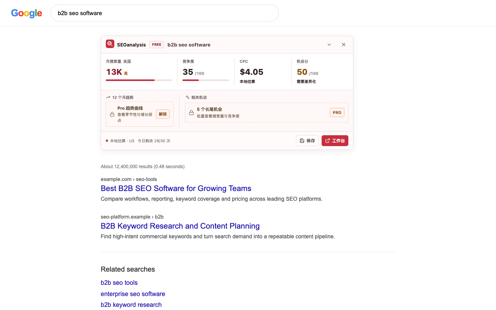
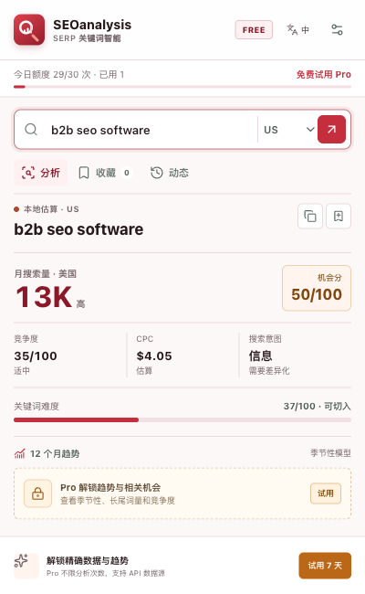
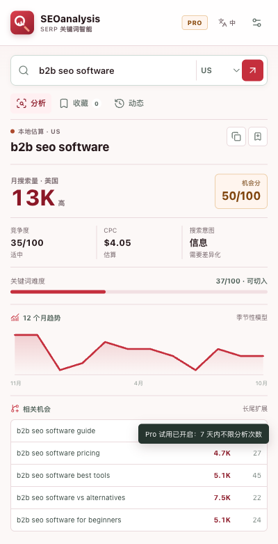
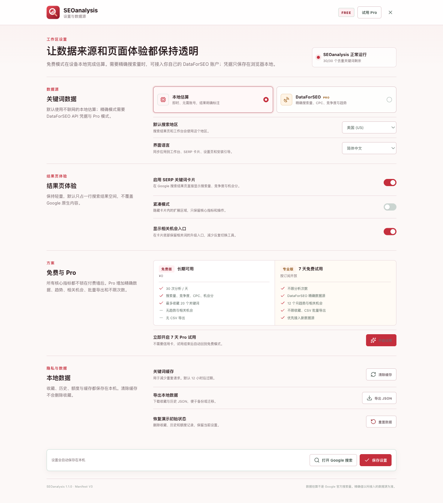
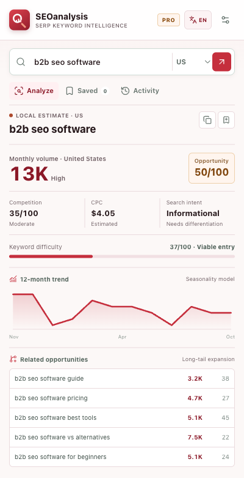
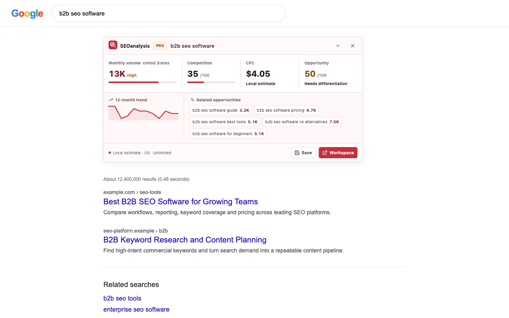

# SEOanalysis

一个在 Google 搜索结果页直接显示关键词判断信息的 Manifest V3 浏览器扩展。目标不是替代完整的 SEO 套件，而是减少每天几十次“查一个词、切一个工具、再切回来”的重复动作。



## 产品定位

SEOanalysis 围绕一次具体决策：

- 这个词有没有需求？
- 竞争是否值得投入？
- 商业价值大概如何？
- 有没有更具体的长尾机会？

免费版提供可长期使用的本地估算、透明配额和核心四指标。Pro 版开放精确数据源、12 个月趋势、相关机会、不限分析次数与 CSV 导出。

## 功能

### 免费版

- Google 搜索结果页内嵌关键词卡片，不覆盖搜索结果
- 月搜索量、竞争度、CPC、机会分
- 搜索意图与关键词难度
- 简体中文与 English 运行时切换，默认跟随浏览器语言
- 地区切换：美国、中国、英国、德国、日本、新加坡
- 每天 30 次分析
- 最多收藏 20 个关键词
- 本地历史记录与摘要复制
- 所有估算明确标注 `本地估算`，不伪装成精确数据

### Pro 版

- 不限分析次数
- 接入用户自己的 DataForSEO 精确数据
- 12 个月趋势曲线
- 5 个相关长尾机会
- 不限收藏
- CSV 批量导出
- 精确数据与估算自动区分，API 失败时回退到本地估算并显示原因

Pro 提供 7 天本地试用，便于完整体验功能。仓库内没有绑定真实支付平台；正式发布前需要把试用/订阅激活替换为服务端许可证校验。

## 安装

1. 打开 Chrome 的 `chrome://extensions`。
2. 开启右上角“开发者模式”。
3. 点击“加载已解压的扩展程序”。
4. 选择本项目根目录。
5. 打开任意 Google 搜索结果页，卡片会出现在结果列表上方。

扩展是零构建结构，不需要 `npm install` 或打包命令。`node_modules/` 仅用于本地 UI 自动化测试，不是扩展运行依赖。

## 数据说明

### 免费本地估算

关键词指标由 [src/engine.js](src/engine.js) 中的确定性本地模型生成。模型综合词长、词数、商业意图、信息意图、头部词与地区权重，并使用固定哈希保证同一关键词结果稳定。

本地估算适合：

- 快速比较同组词的相对机会
- 排除明显不值得投入的长尾词
- 在无账号、无 API、无额度成本的情况下完成初筛

本地估算不适合：

- 作为广告预算或客户报告中的精确搜索量
- 替代 Google Keyword Planner、Search Console 或商业关键词数据库

界面始终显示数据来源。精确值只在 Pro + DataForSEO 配置成功后出现。

### DataForSEO

设置页支持 DataForSEO 的 Google Ads Search Volume Live API：

- Endpoint: `keywords_data/google_ads/search_volume/live`
- 凭据只保存在 `chrome.storage.local`
- 精确结果缓存 12 小时
- 免费版不会发送关键词到该 API
- API 出错时回退到本地估算，不会静默展示错误值

## 截图

| 工作台 | Pro 分析 |
| --- | --- |
|  |  |

| 设置页 | 安装完成 |
| --- | --- |
|  |  |

| English 工作台 | English SERP |
| --- | --- |
|  |  |

## 项目结构

```text
manifest.json
_locales/               Chrome 中英文扩展元数据
assets/                 品牌 SVG 与 16/32/48/128 PNG
src/
  background.js         Manifest V3 service worker、额度、缓存与 API
  engine.js             本地估算、意图判断、趋势与 DataForSEO 映射
  i18n.js               中英文词条、语言解析与错误本地化
  content.js            Google SERP Shadow DOM 卡片
  popup.html/css/js     关键词工作台
  options.html/css/js   数据源、地区和隐私设置
  welcome.html/css/js   安装后的三步引导
vendor/lucide.min.js    本地打包的 Lucide 图标
tests/                  数据测试、Chrome 自动化与 SERP 夹具
docs/                   研究、商店文案与权限说明
output/screenshots/     自动化截图
```

## 测试

```bash
npm test
npm run validate
npm install
npx playwright install chromium
npm run test:ui
```

- `npm test`：本地估算确定性、地区权重、DataForSEO 映射、格式化与中英文词条测试
- `npm run validate`：Manifest 引用文件、权限范围和必需资源检查
- `npm run test:ui`：Chrome for Testing 加载扩展，检查中英文 popup、设置页、onboarding、Pro 解锁和 SERP 注入位置

SERP 测试使用与 `https://www.google.com/search` 同源的本地 Google 结构夹具，通过 Playwright 网络拦截返回。这样可以验证扩展的匹配和注入逻辑，同时不绕过 Google 的自动化验证。

## 图标

品牌图标是代码原生矢量资产，适合 16px 工具栏尺寸：

- 源文件：`assets/icon.svg`
- 导出尺寸：`assets/icon-16.png`、`32`、`48`、`128`
- 视觉：枢机红放大镜代表搜索与行动，白色柱状图代表关键词数据，珊瑚色手柄建立品牌记忆点

## 研究

Keywords Everywhere 的产品与差评研究、设计取舍和免费/Pro 边界见 [docs/RESEARCH.md](docs/RESEARCH.md)。

## 已知边界

- 当前只支持 Google Search 桌面结果页。
- 本地估算不是官方搜索量。
- DataForSEO 需要用户自己的账号；扩展不转售或代管 API 凭据。
- 支付、许可证校验、服务端额度同步尚未接入，当前 Pro 试用为本地演示实现。
- Google SERP DOM 会变化，内容脚本已使用多个锚点与 MutationObserver，但正式上架后仍应持续做真实账号环境回归。

## 隐私

详见 [PRIVACY.md](PRIVACY.md)。
